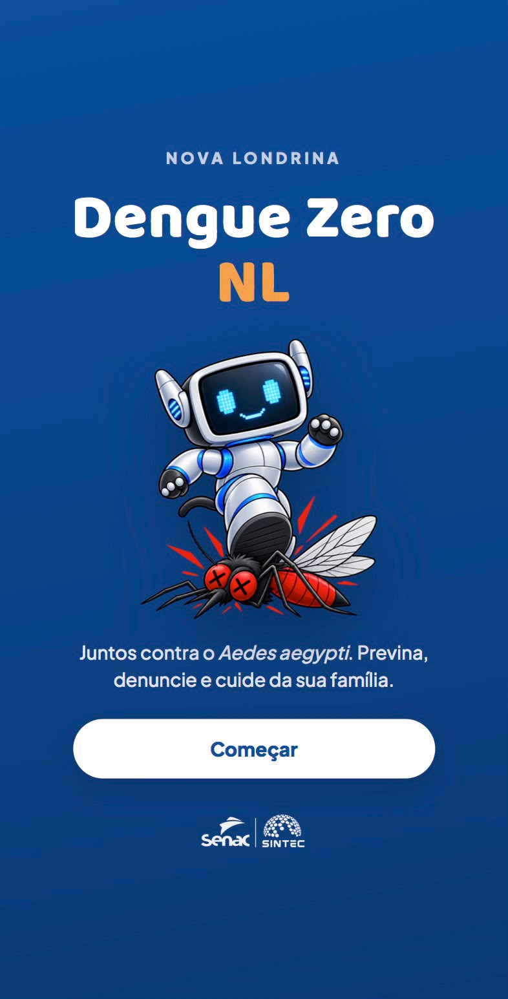
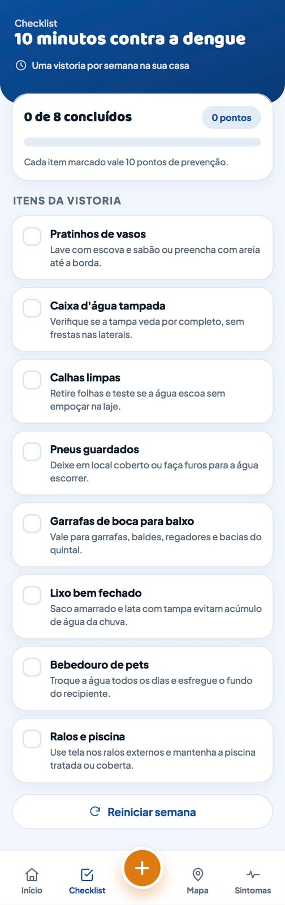
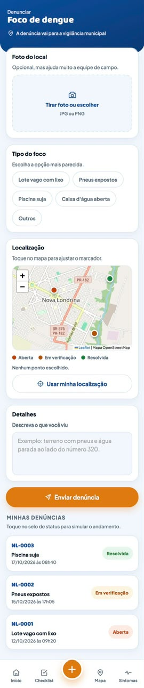
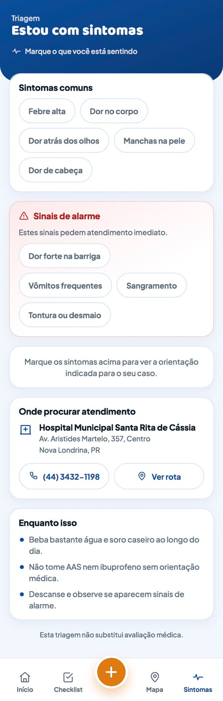
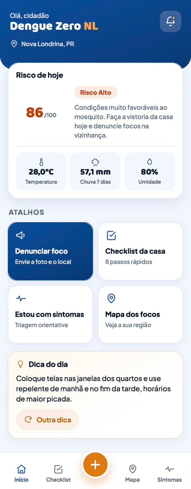

<div align="center">



# Dengue Zero NL

**Aplicativo web mobile de combate à dengue para Nova Londrina (PR)**

🏆 3º lugar no Hackathon SINTEC (Senac)

<a href="https://othomasgoncalves.github.io/hackaton-sintec/">
  
</a>

<sub>💡 Melhor visualizado no celular ou com o modo responsivo do navegador (F12 → ícone de celular)</sub>

<br><br>


</div>

---

## 📌 Sobre o projeto

A dengue é um problema recorrente em cidades do interior, e boa parte dos focos do *Aedes aegypti* está dentro das próprias casas. O **Dengue Zero NL** coloca a prevenção na mão do morador: mostra o risco do dia, guia uma vistoria semanal rápida, permite denunciar focos à vigilância municipal e orienta quem está com sintomas sobre onde buscar atendimento.

O projeto foi desenvolvido no **Hackathon SINTEC (Senac)**, cujo desafio era criar uma interface com experiência de aplicativo mobile para o combate às endemias, avaliada por utilidade, experiência mobile, acessibilidade, organização e uso inteligente de tecnologia e IA.

> [!NOTE]
> Este é um protótipo focado no front-end, como pedia o desafio. As denúncias e seus status são simulados na própria interface.

## 📱 Telas

<table>
  <tr>
    <td align="center" valign="top" width="25%">
      <br>
      <b>Início</b><br>
      <sub>Risco do dia, clima e atalhos</sub>
    </td>
    <td align="center" valign="top" width="25%">
      <br>
      <b>Checklist</b><br>
      <sub>Vistoria de 10 minutos com pontuação</sub>
    </td>
    <td align="center" valign="top" width="25%">
      <br>
      <b>Denúncia</b><br>
      <sub>Foto, tipo do foco e localização no mapa</sub>
    </td>
    <td align="center" valign="top" width="25%">
      <br>
      <b>Sintomas</b><br>
      <sub>Triagem e sinais de alarme</sub>
    </td>
  </tr>
</table>

## ✨ Funcionalidades

- **Risco de hoje:** índice de 0 a 100 calculado a partir de temperatura, chuva acumulada dos últimos 7 dias e umidade, com recomendação de ação para o dia.
- **Checklist da casa:** 8 itens de vistoria semanal (vasos, caixa d'água, calhas, pneus e outros), com barra de progresso e pontos de prevenção.
- **Denúncia de foco:** envio com foto, tipo do foco, localização no mapa ou pelo GPS e acompanhamento do status (aberta, em verificação, resolvida).
- **Mapa dos focos:** visualização dos focos denunciados na cidade com Leaflet e OpenStreetMap.
- **Triagem de sintomas:** separa sintomas comuns de sinais de alarme e indica a unidade de saúde de referência, com telefone e rota.
- **Dica do dia:** orientações rápidas de prevenção que se alternam.

## 🧠 Decisões de design

- **Mobile first:** navegação inferior com botão central de ação rápida, pensada para uso com uma mão.
- **Acessibilidade:** textos curtos, alto contraste, ícones acompanhados de rótulo e sinais de alarme destacados em vermelho.
- **Feedback visual:** status com cores consistentes, progresso visível e pontuação para incentivar a vistoria semanal.
- **Contexto local:** conteúdo pensado para Nova Londrina, com o hospital municipal de referência e o mapa da cidade.

## 🛠️ Tecnologias

| Camada | Tecnologia |
| --- | --- |
| Interface | HTML5, CSS3 e JavaScript |
| Mapa | Leaflet + OpenStreetMap |
| Hospedagem | GitHub Pages |

## 🚀 Como executar localmente

```bash
git clone https://github.com/othomasgoncalves/hackaton-sintec.git
cd hackaton-sintec
```

Depois, abra o `index.html` no navegador ou use uma extensão como o **Live Server** no VS Code.

## 👤 Autor

**Thomás Gonçalves** · Software Engineer | Full Stack Engineer | AI Engineer

[](https://www.linkedin.com/in/othomasgoncalves)
[](https://github.com/othomasgoncalves)